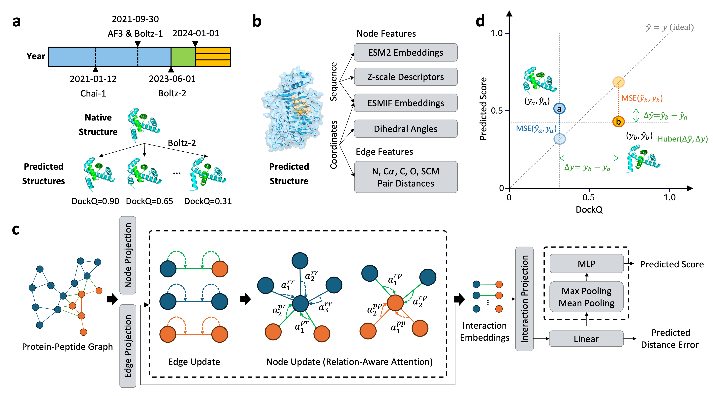

# pepDockQ

**Graph-based quality estimation for peptide–protein complexes.**

`pepDockQ` takes a docked peptide–protein PDB structure as input and predicts
a scalar quality score correlated with the DockQ metric of the underlying
interface. Predictions are made by a heterogeneous graph neural network (HGNN)
over per-residue features that combine ESM-2 sequence embeddings, ESM-IF
inverse-folding mutation scores, side-chain geometry, and Z-scale
physico-chemical descriptors.



Given a folder of docked PDB files, the pipeline:

1. Extracts per-chain sequences from each PDB and computes **ESM-IF**
   inverse-folding features.
2. Computes **ESM-2** per-chain embeddings.
3. Builds a peptide/protein heterogeneous graph and packages all per-residue
   features into a `torch_geometric` `HeteroData` object (one `.pt` file
   per PDB).
4. Loads the trained HGNN checkpoint and writes a CSV of predicted scores.

---

## Requirements

- **Python** 3.9
- **PyTorch** 2.4.0 + CUDA 12.1
- **torch-geometric** wheels for `pt24cu121`
- A CUDA-capable GPU for the embedding and inference stages

All exact pins are in [`requirements.txt`](requirements.txt).

---

## Installation

```bash
conda create -n pepdockq python=3.9 -y
conda activate pepdockq

pip install -r requirements.txt   # PyTorch cu121 + PyG accelerator wheels
pip install -e .                   # the pepDockQ package (editable)
```

The extra index URLs for the `+cu121` PyTorch build and matching
`torch-geometric` accelerator wheels are declared at the top of
[`requirements.txt`](requirements.txt), so a single `pip install` resolves the
full stack.

Fetch the released weights (one-time):

```bash
scripts/download_weights.sh          # writes assets/model.pth
```

The script verifies the SHA-256 of the downloaded file, so it is safe to
re-run.

---

## Inference

The four inference stages are wired together by
[`scripts/run_prediction.sh`](scripts/run_prediction.sh) and configured by
[`configs/predict.env`](configs/predict.env). Every knob has a default that
points at the frozen example under [`examples/`](examples/) and the released
checkpoint under [`assets/`](assets/), so out of the box:

```bash
bash scripts/run_prediction.sh
```

runs the two PDB files under [`examples/pdb/`](examples/pdb/) end-to-end and
writes predictions to `examples/prediction_results.csv`.

| Step | Module | Where it runs |
|------|--------|---------------|
| 1    | [`pepdockq.features.esmif`](pepdockq/features/esmif.py) | GPU |
| 2    | [`pepdockq.features.esm`](pepdockq/features/esm.py)     | GPU |
| 3    | [`pepdockq.features.graph`](pepdockq/features/graph.py) | CPU |
| 4    | [`pepdockq.predict`](pepdockq/predict.py)               | GPU |

To predict on your own data, edit [`configs/predict.env`](configs/predict.env)
— it exposes the input folder, working directory, output CSV path, checkpoint,
Z-scale asset, and stage-3 worker count. Any variable already set in the
environment overrides the config, so a one-off run without editing the file
looks like:

```bash
PDB_DIR=/path/to/pdbs OUTPUT=/tmp/pred.csv bash scripts/run_prediction.sh
```

Intermediate features (`fasta`, `info`, `esm_embedding`, `esmif_embedding`,
`features`, `log`) are created as subfolders of `WORK_DIR`.

The final CSV has two columns:

```csv
decoy_id,pred_score
1abc_model_0,0.712
1abc_model_1,0.483
```

### Running one stage at a time

Each stage is a standalone entry point:

```bash
python -m pepdockq.features.esmif  --pdb_dir ... --fasta_dir ... --info_dir ... --esmif_dir ...
python -m pepdockq.features.esm    --fasta_dir ... --esm_dir ...
python -m pepdockq.features.graph  --pdb_dir ... --esm_dir ... --esmif_dir ... \
                                    --info_dir ... --feature_dir ... --zscale_path ... --ncpus 4
python -m pepdockq.predict         --data_path ... --checkpoint ... --output ...
```

After `pip install -e .`, `pepdockq-predict` and `pepdockq-train` are also
registered as console scripts.

---

## Training

Training is driven by [`scripts/run_training.sh`](scripts/run_training.sh),
configured by [`configs/train.env`](configs/train.env).

**Prerequisites.** Before training you need the pre-computed graph features
for every complex in your training / validation / test splits. Run steps 1–3
of the inference pipeline once on the full set of PDBs — this produces one
`.pt` file per structure under `<feature_dir>/graph`, the value that
`DATA_PATH` in `configs/train.env` should point at. Example split files ship
with the repo under [`data/`](data/README.md); their schema is documented in
[`docs/data_format.md`](docs/data_format.md).

```bash
# Edit configs/train.env to point DATA_PATH at your graph feature directory,
# then:
bash scripts/run_training.sh
```

Any variable already set in the environment overrides the config, and extra
CLI flags are forwarded to `pepdockq.train`:

```bash
EPOCHS=20 bash scripts/run_training.sh --hidden_channels 128 --lambda_pair 0.5
```

Each run writes a timestamped subdirectory under `OUTPUT_DIR` containing:

- `config.json` — a dump of all CLI arguments
- `log.txt` — mirrored stdout
- `checkpoints/model_epoch{N}.pth` — one checkpoint per epoch
- `checkpoints/prediction_epoch{N}.pkl` — per-complex predictions on valid + test
- TensorBoard event files (`tensorboard --logdir outputs/<timestamp>`)

The training objective (see [`pepdockq/models/losses.py`](pepdockq/models/losses.py)):

- **`DockQPairwiseThresholdLoss`** — Huber regression on the global DockQ
  target plus a threshold-aware pairwise ranking term.
- **`EdgeBinnedSoftTargetLoss`** — soft-target cross-entropy over binned
  per-edge distance errors (32 bins over `[-5 Å, 30 Å]`), providing an
  auxiliary local supervision signal on the interface geometry.

Full documentation of the architecture and the feature stack is in
[`docs/architecture.md`](docs/architecture.md).

---

## Repository layout

```
pepDockQ/
├── README.md · LICENSE · CITATION.cff · pyproject.toml · requirements.txt
│
├── assets/
│   ├── amino_acid_zscale.csv          static Z-scale descriptors
│   └── model.pth                       ← fetched by scripts/download_weights.sh
│
├── configs/
│   ├── predict.env                     scripts/run_prediction.sh config
│   └── train.env                       scripts/run_training.sh config
│
├── data/                               training / valid / test split files
│   ├── train.txt
│   ├── valid.tsv
│   └── test.tsv
│
├── docs/
│   ├── architecture.md
│   ├── data_format.md
│   └── figures/
│
├── examples/                           frozen end-to-end demo
│   ├── pdb/                            input PDB files
│   └── prediction_results.csv          expected output
│
├── scripts/
│   ├── download_weights.sh             fetch model.pth from Zenodo
│   ├── run_prediction.sh               end-to-end inference driver
│   └── run_training.sh                 training driver
│
└── pepdockq/                           the installable Python package
    ├── __init__.py
    ├── features/                       PDB → HeteroData
    │   ├── esm.py                      step 2: ESM-2 embeddings
    │   ├── esmif.py                    step 1: ESM-IF features
    │   └── graph.py                    step 3: graph construction
    ├── models/
    │   ├── hgnn.py                     HGNN architecture
    │   └── losses.py                   training losses
    ├── data.py                         training-time datasets & pair samplers
    ├── metrics.py                      evaluation metrics
    ├── predict.py                      step 4: inference → CSV
    └── train.py                        training entry point
```

---

## License

Released under the MIT License — see [`LICENSE`](LICENSE).

## Citation

Publication forthcoming. Citation metadata is tracked in
[`CITATION.cff`](CITATION.cff).
